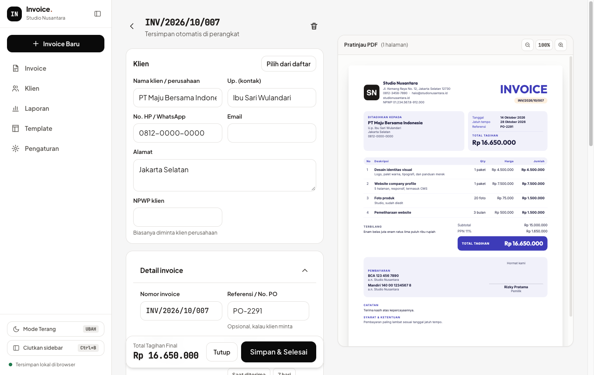

# Invoice Maker — Invoice & Kwitansi

[](https://www.typescriptlang.org/)
[](https://react.dev/)
[](https://react-pdf.org/)
[](docs/teknis.md)
[](docs/teknis.md)
[](LICENSE)
[](https://github.com/rizalahmaddd/invoice-maker/actions/workflows/ci.yml)
[](https://invoice.solusikoding.com)

<p align="center">
  
</p>

**Stack:** TypeScript · React 18 · Vite · Tailwind CSS 4 · [Dexie](https://dexie.org) (IndexedDB) · [@react-pdf/renderer](https://react-pdf.org) · [PDF.js](https://mozilla.github.io/pdf.js/) · Fontsource · Workbox (PWA) · Cloudflare Workers

Aplikasi pembuat invoice dan kwitansi untuk freelancer, UMKM, dan usaha jasa di Indonesia. Hitung PPN dan potongan PPh 23, tulis terbilang otomatis, cetak PDF dengan 24 template siap pakai, lalu kirim langsung lewat WhatsApp. Semua data tersimpan di perangkat Anda, tanpa akun dan tanpa server. Bisa dipasang sebagai aplikasi (PWA) dan tetap jalan offline.

🌐 **Coba demo:** [invoice.solusikoding.com](https://invoice.solusikoding.com)

## Fitur

### Buat invoice
- **Cepat diisi**: Klien tersimpan otomatis, katalog produk & jasa, dan saran item dari riwayat (harga dan satuan terisi sendiri)
- **Tersimpan otomatis**: Setiap ketikan langsung disimpan, aman meski tab ditutup atau HP kehabisan baterai
- **Penomoran fleksibel**: Pola bebas seperti `INV/{YYYY}/{ROMAN}/{SEQ:3}` atau kode klien, reset tahunan/bulanan, dan nomor menyesuaikan saat tanggal dimundurkan
- **Pajak Indonesia**: PPN ditambahkan atau sudah termasuk (dengan DPP), potongan PPh 23, dan terbilang Rupiah
- **Diskon & penyesuaian**: Diskon per item atau total (persen/nominal), ongkir, biaya tambahan, dan potongan DP
- **DP, termin & pelunasan**: Buat tagihan DP atau termin dari nilai proyek, lalu invoice pelunasan yang otomatis dikurangi pembayaran sebelumnya
- **Revisi yang tertib**: Invoice terkirim dikunci; perubahan dibuat sebagai revisi bernomor `-R1` dan versi lama ditandai batal
- **Multi mata uang & dwibahasa**: IDR, USD, SGD, MYR, EUR, AUD, JPY dengan dokumen Bahasa Indonesia atau Inggris
- **Validasi sebelum simpan**: Peringatan untuk klien kosong, nomor ganda, total nol, atau jatuh tempo yang keliru

### Kirim & tagih
- **PDF siap kirim**: Bagikan langsung ke WhatsApp, email, atau aplikasi lain dari HP, atau unduh di desktop
- **Pesan otomatis**: Template pesan dengan nama klien, nomor, total, dan jatuh tempo; berganti jadi pesan pengingat saat invoice hampir atau sudah lewat tempo
- **Status jelas**: Draft, terkirim, dibayar sebagian, lunas, lewat tempo, dan batal
- **Catat pembayaran**: Pembayaran penuh atau cicilan, lalu cetak **kwitansi** bernomor dengan terbilang
- **Rekening & QRIS**: Tampilkan beberapa rekening bank dan gambar QRIS di invoice

### Template & desain
- **24 template bawaan** dalam 14 layout: formal (Arsip, Kop Surat, Korporat, Anggun, Bingkai), modern (Pita, Kartu, Samping, Lengkung), kreatif (Tegas, Studio, Geometri), dan minimal (Garis, Struk)
- **Editor template lengkap**: Palet warna atau ambil warna langsung dari logo, 15 font dan pasangan font siap pakai, gaya tabel, sudut, garis aksen, watermark, dan ukuran huruf
- **Atur isi dokumen**: Tagline, posisi & ukuran logo, 19 bagian yang bisa disembunyikan, dan label yang bisa diganti per bahasa (misalnya "Deskripsi" jadi "Layanan")
- **Ukuran kertas**: A4, F4/Folio, Letter, Legal, dan A5, dengan margin dan kepadatan yang bisa diatur
- **Preview langsung** dengan undo/redo, serta ekspor/impor template antar perangkat
- **Logo, tanda tangan & stempel** dari Pengaturan; latar putih pada foto tanda tangan dan stempel dihapus otomatis

### Laporan & data
- **Dashboard piutang**: Belum lunas, lewat tempo, dan sudah lunas, dipisah per mata uang
- **Laporan**: Tagihan dan penerimaan per bulan, piutang per klien, dan ekspor CSV per tahun
- **Klien langganan**: Lihat semua invoice satu klien dan ulangi invoice terakhirnya dengan sekali ketuk
- **Backup & pindah perangkat**: Ekspor ke satu file JSON, lalu gabungkan atau ganti data di perangkat lain

### Lainnya
- **100% di perangkat & privat**: Data invoice dan klien tidak pernah dikirim ke server mana pun
- **PWA & offline**: Bisa dipasang di HP maupun desktop dan tetap jalan tanpa internet
- **Responsif**: Nyaman dipakai di HP, dengan tema terang/gelap

## Cara kerja

1. Buka [invoice.solusikoding.com](https://invoice.solusikoding.com) atau pasang sebagai aplikasi.
2. Isi profil usaha, rekening, logo, dan tanda tangan di Pengaturan (cukup sekali).
3. Buat invoice: pilih klien, tambah item, atur pajak dan diskon, lihat PDF-nya langsung.
4. Bagikan PDF ke klien, lalu catat pembayaran saat sudah ditransfer dan kirim kwitansinya.

## Mulai cepat

```bash
npm install       # pasang dependensi
npm run dev       # jalankan di http://localhost:5173
npm run build     # build produksi ke folder dist/
```

## Dokumentasi

- [Dokumentasi Teknis](docs/teknis.md): arsitektur, penyimpanan data, perhitungan pajak, penomoran, mesin PDF & template, cache & PWA, serta build & deploy

## Dukung & Donasi

Jika proyek ini bermanfaat bagi Anda, dukung pengembangannya melalui **QRIS**:

<p align="center">
  
  <br>
  <em>Scan QRIS menggunakan BCA, Mandiri, BRI, GoPay, OVO, DANA, ShopeePay, atau mobile banking lainnya.</em>
</p>

## Kontak

Dikembangkan oleh **rizalahmaddd**:
- **WhatsApp**: [+62 857-7777-5477](https://wa.me/6285777775477)
- **GitHub**: [@rizalahmaddd](https://github.com/rizalahmaddd)
- **Lokasi**: Kota Malang, Jawa Timur, Indonesia

## Lisensi

Proyek ini dilisensikan di bawah lisensi [MIT License](LICENSE).  
Font yang dibundel (Plus Jakarta Sans, Inter, IBM Plex Sans, Space Grotesk, Poppins, Montserrat, Outfit, Lora, Playfair Display, Fraunces, DM Serif Display, JetBrains Mono, Space Mono, Arimo, Tinos) memakai SIL Open Font License 1.1, rinciannya ada di [Dokumentasi Teknis](docs/teknis.md#9-lisensi-font).
